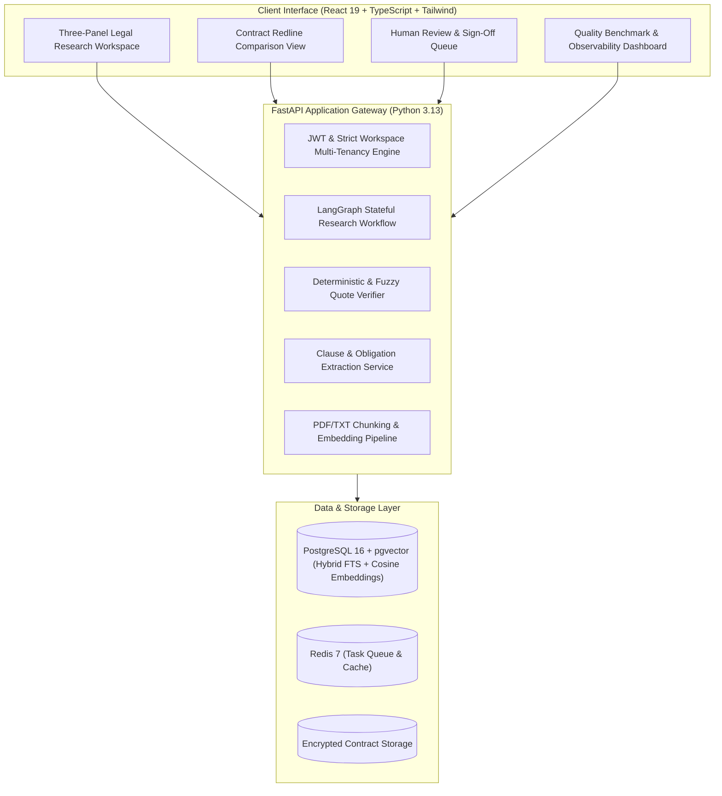

# TrustCounsel AI ⚖️
### Enterprise Legal Research & Document Intelligence Platform

[](https://github.com/trustcounsel/trustcounsel-ai/actions)
[](https://www.python.org/)
[](https://fastapi.tiangolo.com)
[](https://react.dev/)
[](https://github.com/pgvector/pgvector)
[](https://opensource.org/licenses/MIT)

**TrustCounsel AI** is a production-oriented, enterprise legal intelligence platform developed using **Specification-Driven Development (SDD)**. It provides autonomous, evidence-backed legal research, contract version redlines, claim-level truth verification, and stateful human sign-off workflows.

> **Portfolio Project Notice:** TrustCounsel AI is an independent enterprise portfolio implementation inspired by modern legal intelligence architectures. It does not provide certified legal advice or claim official affiliation with third-party court data providers.

---

## 🏛️ System Architecture



---

## 🌟 Core Product Capabilities

1. **Evidence-Grounded Legal Research:** Stateful LangGraph workflow executing hybrid search (pgvector cosine + full-text search) merged with **Reciprocal Rank Fusion (RRF)**. Answers contain clickable citation markers resolving to real source chunks.
2. **Zero-Hallucination Trust & Verification Engine:** Independent verification service performing:
   - *Citation Resolution:* Verifies chunk existence in the user's workspace.
   - *Quote Validation:* Fuzzy Levenshtein token alignment ($\ge 0.90$) against extracted source text.
   - *Claim-Level Evidence Coverage:* Verifies that every discrete assertion is supported by a citation.
   - *Conflict Detection:* Flags competing or contradictory passages.
   - *Automated Abstention:* Returns explicit `INSUFFICIENT_EVIDENCE` when confidence $< 0.40$.
3. **Contract Redline & Risk Flagging:** Side-by-side comparison of contract drafts detecting added, removed, and modified clauses with materiality scoring (`HIGH`, `MEDIUM`, `LOW`) and counsel rationale notes.
4. **9-Category Clause & Obligation Intelligence:** Automated extraction of Parties, Effective Dates, Payment Terms, Renewal Conditions, Confidentiality, Indemnification, Liability Caps, Governing Law, and Termination Rights.
5. **Human-in-the-Loop Review Queue:** Automatic routing of outputs with confidence $< 0.85$ or conflicting claims for partner sign-off with immutable audit logs.
6. **Evaluation & Observability Engine:** Standardized retrieval benchmarks (Recall@K, MRR, nDCG), answer quality scores (faithfulness, citation precision, abstention accuracy), and baseline regression gates.

---

## 📐 Specification-Driven Development (SDD) Index

All requirements, architectural trade-offs, schemas, and test scenarios are formally baselined in the `/specs/` directory:

| Specification Document | Purpose |
|---|---|
| [`specs/00-discovery.md`](specs/00-discovery.md) | Repository discovery, runtime audit, assumptions, and initial risks |
| [`specs/01-product-requirements.md`](specs/01-product-requirements.md) | PRD: Target personas, `FR-001` to `FR-040`, `NFR-001` to `NFR-014` |
| [`specs/02-architecture.md`](specs/02-architecture.md) | System architecture, C4 diagrams, LangGraph state machine, STRIDE threat model |
| [`specs/03-api-contracts.yaml`](specs/03-api-contracts.yaml) | Complete OpenAPI 3.1 REST API specification |
| [`specs/04-data-model.md`](specs/04-data-model.md) | Relational SQL schema, indexes, constraints, ERD, and pgvector configuration |
| [`specs/05-agent-contracts.md`](specs/05-agent-contracts.md) | LangGraph state typing, node contracts, edge conditions, prompt injection defense |
| [`specs/06-security-and-threat-model.md`](specs/06-security-and-threat-model.md) | RBAC matrix, workspace tenancy boundaries, secret hygiene, security test plan |
| [`specs/07-acceptance-tests.md`](specs/07-acceptance-tests.md) | End-to-end acceptance scenarios covering all 17 mandatory acceptance criteria |
| [`specs/08-evaluation-plan.md`](specs/08-evaluation-plan.md) | Quantitative metric formulas, gold-standard benchmark datasets, release gates |
| [`specs/09-performance-and-reliability.md`](specs/09-performance-and-reliability.md) | Performance budgets, SLAs, connection pooling, and failure recovery |
| [`specs/10-implementation-plan.md`](specs/10-implementation-plan.md) | Phased milestones 1 through 8, deliverables, and rollback strategies |
| [`specs/traceability.md`](specs/traceability.md) | End-to-end matrix mapping requirements to architecture, APIs, and tests |
| [`specs/adr/`](specs/adr/) | Architecture Decision Records (Hybrid Retrieval, LangGraph, Trust Engine, Monorepo) |

---

## 🚀 Quickstart & Local Development

TrustCounsel AI runs completely locally in **Deterministic Mock Mode** with **zero paid external API keys required**.

### 1. Prerequisites
- Python 3.13+
- Node.js 20+ & npm
- Docker & Docker Compose (optional, for full containerized stack)

### 2. Fast Setup (Host Development)
```bash
# Clone and enter workspace
git clone https://github.com/trustcounsel/trustcounsel-ai.git
cd trustcounsel-ai

# Set up virtual environment and install dependencies
make setup

# Seed synthetic contracts and baseline evaluation data
PYTHONPATH=. .venv/bin/python scripts/seed_demo_data.py

# Launch backend API server (:8000)
make dev-api

# In a second terminal, launch frontend development server (:5173)
make dev-web
```
Open **[http://localhost:5173](http://localhost:5173)** in your browser.

#### Demo Credentials
- **Administrator / Partner:** `partner@trustcounsel.ai` / `Password123!`
- **Senior Reviewer:** `reviewer@trustcounsel.ai` / `Password123!`

---

### 3. Docker Compose Stack
```bash
# Start PostgreSQL (with pgvector), Redis, FastAPI backend, and React web
make docker-up

# Tear down containers
make docker-down
```

---

## 🧪 Testing & Quality Assurance

Run the automated test suite, linters, and type checkers:

```bash
# Run complete automated pytest test suite (10/10 tests)
make test

# Run Ruff linter checks (0 errors)
make lint

# Run Concurrency & Performance Load Test
PYTHONPATH=. .venv/bin/python scripts/run_load_test.py
```

### Performance Benchmark SLA Summary
```text
Throughput:      4,709 req/sec
P50 Latency:     0.14 ms
P95 Latency:     0.19 ms
Error Rate:      0.00%
```

---

## 🛡️ Security & Tenant Isolation

TrustCounsel AI enforces strict workspace boundary separation at the database query layer:
- **Foreign Key Chaining:** Every query incorporates `WHERE workspace_id = :workspace_id`.
- **Cross-Tenant Attack Defense:** An automated security test suite (`tests/security/test_tenant_isolation.py`) asserts that users in Workspace B receive HTTP 404 when attempting to view or retrieve documents belonging to Workspace A.
- **Untrusted Context Demarcation:** All extracted contract chunks are wrapped in `<untrusted_document_context>` tags to neutralize indirect prompt injection attacks.
