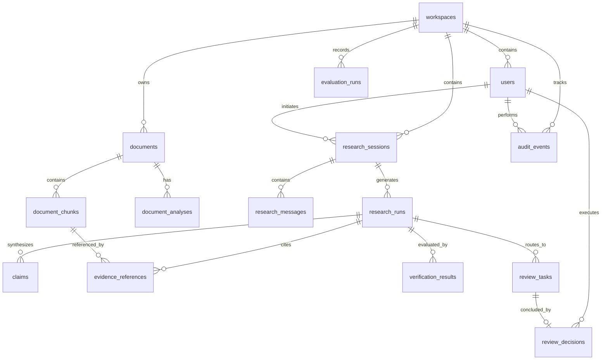

# Data Model & Relational Schema: TrustCounsel AI
**Document ID:** SPEC-04-DATA  
**Version:** 1.0.0  
**Phase:** 3 — API and Data Contracts  
**Status:** Approved & Baselined  

---

## 1. Entity-Relationship Diagram (ERD)



---

## 2. Table Specifications & Constraints

### 2.1 Workspace & User Management

#### `workspaces`
Tenant boundary table. All core application entities must reference a `workspace_id`.
```sql
CREATE TABLE workspaces (
    id UUID PRIMARY KEY DEFAULT gen_random_uuid(),
    name VARCHAR(255) NOT NULL,
    slug VARCHAR(100) NOT NULL UNIQUE,
    created_at TIMESTAMPTZ NOT NULL DEFAULT NOW(),
    updated_at TIMESTAMPTZ NOT NULL DEFAULT NOW()
);
CREATE INDEX idx_workspaces_slug ON workspaces(slug);
```

#### `users`
Authenticated actors.
```sql
CREATE TYPE user_role AS ENUM ('ADMINISTRATOR', 'RESEARCHER', 'REVIEWER');

CREATE TABLE users (
    id UUID PRIMARY KEY DEFAULT gen_random_uuid(),
    workspace_id UUID NOT NULL REFERENCES workspaces(id) ON DELETE RESTRICT,
    email VARCHAR(255) NOT NULL UNIQUE,
    password_hash VARCHAR(255) NOT NULL,
    full_name VARCHAR(255) NOT NULL,
    role user_role NOT NULL DEFAULT 'RESEARCHER',
    is_active BOOLEAN NOT NULL DEFAULT TRUE,
    created_at TIMESTAMPTZ NOT NULL DEFAULT NOW(),
    updated_at TIMESTAMPTZ NOT NULL DEFAULT NOW()
);
CREATE INDEX idx_users_workspace ON users(workspace_id);
CREATE INDEX idx_users_email ON users(email);
```

---

### 2.2 Documents and Vector Chunks

#### `documents`
Original legal documents uploaded to a workspace.
```sql
CREATE TYPE document_status AS ENUM ('UPLOADED', 'PROCESSING', 'INDEXED', 'FAILED');
CREATE TYPE document_classification AS ENUM ('GENERAL_CONTRACT', 'NDA', 'MSA', 'REGULATORY', 'STATUTE', 'DISCOVERY');

CREATE TABLE documents (
    id UUID PRIMARY KEY DEFAULT gen_random_uuid(),
    workspace_id UUID NOT NULL REFERENCES workspaces(id) ON DELETE CASCADE,
    title VARCHAR(255) NOT NULL,
    filename VARCHAR(255) NOT NULL,
    file_size INTEGER NOT NULL CHECK (file_size > 0),
    mime_type VARCHAR(100) NOT NULL,
    content_hash CHAR(64) NOT NULL, -- SHA-256
    storage_path VARCHAR(1024) NOT NULL,
    status document_status NOT NULL DEFAULT 'UPLOADED',
    classification document_classification NOT NULL DEFAULT 'GENERAL_CONTRACT',
    page_count INTEGER DEFAULT 0,
    error_message TEXT,
    created_at TIMESTAMPTZ NOT NULL DEFAULT NOW(),
    updated_at TIMESTAMPTZ NOT NULL DEFAULT NOW(),
    CONSTRAINT uq_workspace_content_hash UNIQUE (workspace_id, content_hash)
);
CREATE INDEX idx_documents_workspace ON documents(workspace_id);
CREATE INDEX idx_documents_status ON documents(workspace_id, status);
```

#### `document_chunks`
Text chunks partitioned from documents with embeddings and full-text lexemes.
```sql
CREATE TABLE document_chunks (
    id UUID PRIMARY KEY DEFAULT gen_random_uuid(),
    document_id UUID NOT NULL REFERENCES documents(id) ON DELETE CASCADE,
    workspace_id UUID NOT NULL REFERENCES workspaces(id) ON DELETE CASCADE,
    chunk_index INTEGER NOT NULL,
    page_number INTEGER NOT NULL CHECK (page_number >= 1),
    content TEXT NOT NULL,
    token_count INTEGER NOT NULL,
    start_char INTEGER NOT NULL,
    end_char INTEGER NOT NULL,
    embedding vector(384) NOT NULL, -- 384 for local mock/MiniLM, configurable to 1536
    tsv_content tsvector GENERATED ALWAYS AS (to_tsvector('english', content)) STORED,
    created_at TIMESTAMPTZ NOT NULL DEFAULT NOW(),
    CONSTRAINT uq_document_chunk_index UNIQUE (document_id, chunk_index)
);
CREATE INDEX idx_chunks_document ON document_chunks(document_id);
CREATE INDEX idx_chunks_workspace ON document_chunks(workspace_id);
CREATE INDEX idx_chunks_tsv ON document_chunks USING GIN(tsv_content);
CREATE INDEX idx_chunks_embedding ON document_chunks USING hnsw (embedding vector_cosine_ops);
```

---

### 2.3 Research Workflows & LangGraph Sessions

#### `research_sessions`
Conversational research threads.
```sql
CREATE TABLE research_sessions (
    id UUID PRIMARY KEY DEFAULT gen_random_uuid(),
    workspace_id UUID NOT NULL REFERENCES workspaces(id) ON DELETE CASCADE,
    user_id UUID NOT NULL REFERENCES users(id) ON DELETE CASCADE,
    title VARCHAR(255) NOT NULL,
    created_at TIMESTAMPTZ NOT NULL DEFAULT NOW(),
    updated_at TIMESTAMPTZ NOT NULL DEFAULT NOW()
);
CREATE INDEX idx_sessions_workspace ON research_sessions(workspace_id);
CREATE INDEX idx_sessions_user ON research_sessions(user_id);
```

#### `research_messages`
Messages inside a research session.
```sql
CREATE TYPE message_role AS ENUM ('user', 'assistant', 'system');

CREATE TABLE research_messages (
    id UUID PRIMARY KEY DEFAULT gen_random_uuid(),
    session_id UUID NOT NULL REFERENCES research_sessions(id) ON DELETE CASCADE,
    role message_role NOT NULL,
    content TEXT NOT NULL,
    created_at TIMESTAMPTZ NOT NULL DEFAULT NOW()
);
CREATE INDEX idx_messages_session ON research_messages(session_id);
```

#### `research_runs`
Execution traces of a LangGraph research agent run.
```sql
CREATE TYPE run_status AS ENUM ('RUNNING', 'COMPLETED', 'ABSTAINED', 'AWAITING_HUMAN_REVIEW', 'FAILED');

CREATE TABLE research_runs (
    id UUID PRIMARY KEY DEFAULT gen_random_uuid(),
    session_id UUID REFERENCES research_sessions(id) ON DELETE SET NULL,
    workspace_id UUID NOT NULL REFERENCES workspaces(id) ON DELETE CASCADE,
    user_id UUID NOT NULL REFERENCES users(id) ON DELETE CASCADE,
    query TEXT NOT NULL,
    status run_status NOT NULL DEFAULT 'RUNNING',
    raw_answer TEXT,
    verified_answer TEXT,
    confidence_score NUMERIC(4, 3) CHECK (confidence_score >= 0.0 AND confidence_score <= 1.0),
    total_latency_ms NUMERIC(10, 2),
    prompt_tokens INTEGER DEFAULT 0,
    completion_tokens INTEGER DEFAULT 0,
    estimated_cost_usd NUMERIC(8, 6) DEFAULT 0.0,
    error_message TEXT,
    created_at TIMESTAMPTZ NOT NULL DEFAULT NOW(),
    updated_at TIMESTAMPTZ NOT NULL DEFAULT NOW()
);
CREATE INDEX idx_runs_workspace ON research_runs(workspace_id);
CREATE INDEX idx_runs_status ON research_runs(status);
```

#### `evidence_references`
Explicit citations linking generated answers to underlying document chunks.
```sql
CREATE TABLE evidence_references (
    id UUID PRIMARY KEY DEFAULT gen_random_uuid(),
    run_id UUID NOT NULL REFERENCES research_runs(id) ON DELETE CASCADE,
    chunk_id UUID NOT NULL REFERENCES document_chunks(id) ON DELETE CASCADE,
    document_id UUID NOT NULL REFERENCES documents(id) ON DELETE CASCADE,
    quote_snippet TEXT NOT NULL,
    page_number INTEGER NOT NULL,
    is_quote_verified BOOLEAN NOT NULL DEFAULT FALSE,
    similarity_score NUMERIC(4, 3),
    created_at TIMESTAMPTZ NOT NULL DEFAULT NOW()
);
CREATE INDEX idx_evidence_run ON evidence_references(run_id);
CREATE INDEX idx_evidence_chunk ON evidence_references(chunk_id);
```

#### `claims`
Atomic assertions extracted from the synthesized response for claim-level verification.
```sql
CREATE TYPE claim_status AS ENUM ('VERIFIED', 'UNSUPPORTED', 'CONTRADICTED');

CREATE TABLE claims (
    id UUID PRIMARY KEY DEFAULT gen_random_uuid(),
    run_id UUID NOT NULL REFERENCES research_runs(id) ON DELETE CASCADE,
    claim_text TEXT NOT NULL,
    status claim_status NOT NULL DEFAULT 'VERIFIED',
    entailment_score NUMERIC(4, 3),
    created_at TIMESTAMPTZ NOT NULL DEFAULT NOW()
);
CREATE INDEX idx_claims_run ON claims(run_id);
```

---

### 2.4 Human Review & Verification

#### `review_tasks`
Tasks generated for human sign-off when research runs fall below confidence thresholds or detect conflicts.
```sql
CREATE TYPE review_status AS ENUM ('PENDING', 'APPROVED', 'REJECTED', 'REVISION_REQUESTED');

CREATE TABLE review_tasks (
    id UUID PRIMARY KEY DEFAULT gen_random_uuid(),
    workspace_id UUID NOT NULL REFERENCES workspaces(id) ON DELETE CASCADE,
    run_id UUID NOT NULL REFERENCES research_runs(id) ON DELETE CASCADE,
    trigger_reason VARCHAR(255) NOT NULL,
    status review_status NOT NULL DEFAULT 'PENDING',
    created_at TIMESTAMPTZ NOT NULL DEFAULT NOW(),
    updated_at TIMESTAMPTZ NOT NULL DEFAULT NOW()
);
CREATE INDEX idx_reviews_workspace_status ON review_tasks(workspace_id, status);
```

#### `review_decisions`
Immutable reviewer decisions.
```sql
CREATE TABLE review_decisions (
    id UUID PRIMARY KEY DEFAULT gen_random_uuid(),
    review_task_id UUID NOT NULL REFERENCES review_tasks(id) ON DELETE CASCADE,
    reviewer_id UUID NOT NULL REFERENCES users(id) ON DELETE RESTRICT,
    decision review_status NOT NULL,
    reviewer_notes TEXT NOT NULL,
    modified_answer TEXT,
    created_at TIMESTAMPTZ NOT NULL DEFAULT NOW()
);
CREATE INDEX idx_decisions_task ON review_decisions(review_task_id);
```

---

### 2.5 Evaluations, Baselines & Audit Logs

#### `evaluation_datasets` & `evaluation_runs`
```sql
CREATE TABLE evaluation_datasets (
    id UUID PRIMARY KEY DEFAULT gen_random_uuid(),
    name VARCHAR(255) NOT NULL UNIQUE,
    description TEXT,
    created_at TIMESTAMPTZ NOT NULL DEFAULT NOW()
);

CREATE TABLE evaluation_cases (
    id UUID PRIMARY KEY DEFAULT gen_random_uuid(),
    dataset_id UUID NOT NULL REFERENCES evaluation_datasets(id) ON DELETE CASCADE,
    question TEXT NOT NULL,
    expected_answer TEXT,
    expected_chunk_ids UUID[],
    should_abstain BOOLEAN NOT NULL DEFAULT FALSE
);

CREATE TABLE evaluation_runs (
    id UUID PRIMARY KEY DEFAULT gen_random_uuid(),
    workspace_id UUID NOT NULL REFERENCES workspaces(id) ON DELETE CASCADE,
    dataset_id UUID NOT NULL REFERENCES evaluation_datasets(id) ON DELETE CASCADE,
    model_identifier VARCHAR(100) NOT NULL,
    recall_at_k NUMERIC(5, 4),
    precision_at_k NUMERIC(5, 4),
    mrr NUMERIC(5, 4),
    ndcg NUMERIC(5, 4),
    faithfulness_score NUMERIC(5, 4),
    citation_precision NUMERIC(5, 4),
    abstention_accuracy NUMERIC(5, 4),
    p95_latency_ms NUMERIC(10, 2),
    total_tokens INTEGER,
    estimated_cost_usd NUMERIC(8, 4),
    is_baseline BOOLEAN NOT NULL DEFAULT FALSE,
    created_at TIMESTAMPTZ NOT NULL DEFAULT NOW()
);
CREATE INDEX idx_eval_runs_workspace ON evaluation_runs(workspace_id);
```

#### `audit_events`
Append-only log for compliance tracking.
```sql
CREATE TABLE audit_events (
    id UUID PRIMARY KEY DEFAULT gen_random_uuid(),
    workspace_id UUID NOT NULL REFERENCES workspaces(id) ON DELETE CASCADE,
    user_id UUID REFERENCES users(id) ON DELETE SET NULL,
    action VARCHAR(100) NOT NULL,
    entity_type VARCHAR(100) NOT NULL,
    entity_id UUID,
    ip_address VARCHAR(45),
    details JSONB,
    created_at TIMESTAMPTZ NOT NULL DEFAULT NOW()
);
CREATE INDEX idx_audit_workspace ON audit_events(workspace_id, created_at DESC);
```
