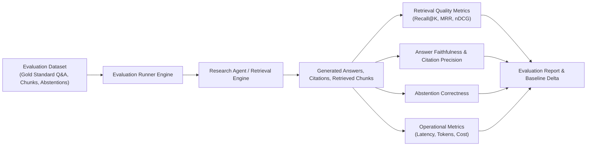

# Evaluation Plan & Quality Benchmarks: TrustCounsel AI
**Document ID:** SPEC-08-EVAL  
**Version:** 1.0.0  
**Phase:** 4 — Test Specifications  
**Status:** Approved & Baselined  

---

## 1. Evaluation Architecture & Pipeline

In legal AI, quality cannot rely on generic perplexity or informal vibe checks. TrustCounsel AI provides an automated evaluation pipeline that computes standardized metrics against curated gold-standard benchmark datasets.

---

## 2. Quantitative Metric Formulations

### 2.1 Retrieval Quality Metrics

1. **Recall@K:** Proportion of relevant golden chunks retrieved in the top $K$ candidates:
   $$\text{Recall@K} = \frac{|\text{Retrieved}_K \cap \text{Relevant}|}{|\text{Relevant}|}$$
   *Target Threshold:* $\ge 0.85$ at $K=5$.

2. **Precision@K:** Proportion of retrieved chunks in the top $K$ that are genuinely relevant:
   $$\text{Precision@K} = \frac{|\text{Retrieved}_K \cap \text{Relevant}|}{K}$$
   *Target Threshold:* $\ge 0.60$ at $K=5$.

3. **Mean Reciprocal Rank (MRR):** Evaluates how high the first relevant chunk appears:
   $$\text{MRR} = \frac{1}{|Q|} \sum_{i=1}^{|Q|} \frac{1}{\text{rank}_i}$$
   *Target Threshold:* $\ge 0.75$.

4. **Normalized Discounted Cumulative Gain (nDCG@K):** Accounts for position-dependent relevance ranking.
   *Target Threshold:* $\ge 0.80$.

---

### 2.2 Answer Quality & Grounding Metrics

1. **Citation Precision:** Proportion of generated citations that resolve to real chunks in the workspace with accurate quote matching:
   $$\text{Citation Precision} = \frac{|\text{Verified Citations}|}{|\text{Total Generated Citations}|}$$
   *Target Threshold:* $\ge 0.98$ (Near-zero tolerance for fabricated citations).

2. **Claim-Level Evidence Coverage:** Proportion of factual claims in the answer supported by at least one verified citation:
   $$\text{Evidence Coverage} = \frac{|\text{Grounded Claims}|}{|\text{Total Claims}|}$$
   *Target Threshold:* $\ge 0.90$.

3. **Faithfulness Score:** Evaluates whether statements in the answer are logically entailed by the retrieved context without ungrounded external assumptions.
   *Target Threshold:* $\ge 0.90$.

4. **Abstention Accuracy:** Proportion of out-of-scope or unanswerable queries on which the agent correctly triggers `ABSTAINED` rather than generating speculative answers:
   $$\text{Abstention Accuracy} = \frac{\text{Correct Abstentions}}{\text{Total Unanswerable Cases}}$$
   *Target Threshold:* $\ge 0.95$.

---

### 2.3 Operational & Financial Metrics

1. **Latency Distribution:**
   - Retrieval Latency: P50 $< 100\text{ms}$, P95 $< 250\text{ms}$.
   - End-to-End Research Latency: P50 $< 2.5\text{s}$, P95 $< 6.0\text{s}$ (with mock or fast hosted models).
2. **Token Efficiency:**
   - Average prompt tokens per query: $< 1,500$.
   - Average completion tokens per answer: $< 500$.
3. **Cost per Request:**
   - Calculated dynamically based on model pricing table (e.g. \$0.0015 / 1K tokens for small models).

---

## 3. Gold-Standard Evaluation Datasets

The evaluation suite incorporates synthetic, legally sound benchmark contracts:
- `legal_qa_contracts_v1.json`: 30 complex legal questions with labeled ground-truth chunks and reference answers covering liability caps, indemnification triggers, non-competes, and termination rights.
- `unanswerable_questions_v1.json`: 15 queries deliberately designed to test abstention (questions outside the scope of the document collection, e.g. asking about intellectual property assignments when only an NDA is indexed).
- `contract_diff_cases_v1.json`: 5 paired contract drafts with human-labeled added, removed, and modified clauses with ground-truth materiality ratings.

---

## 4. Release Gates & Regression Detection

Before any model configuration or prompt template can be promoted to production:
1. Automated evaluation run executes against `legal_qa_contracts_v1.json`.
2. Delas are computed against the established baseline:
   - Citation Precision must not drop by $> 0.0\%$.
   - Faithfulness must not drop by $> 2.0\%$.
   - P95 latency must not increase by $> 15\%$.
3. If any gate fails, the evaluation run reports `REGRESSION_DETECTED` and blocks deployment.
